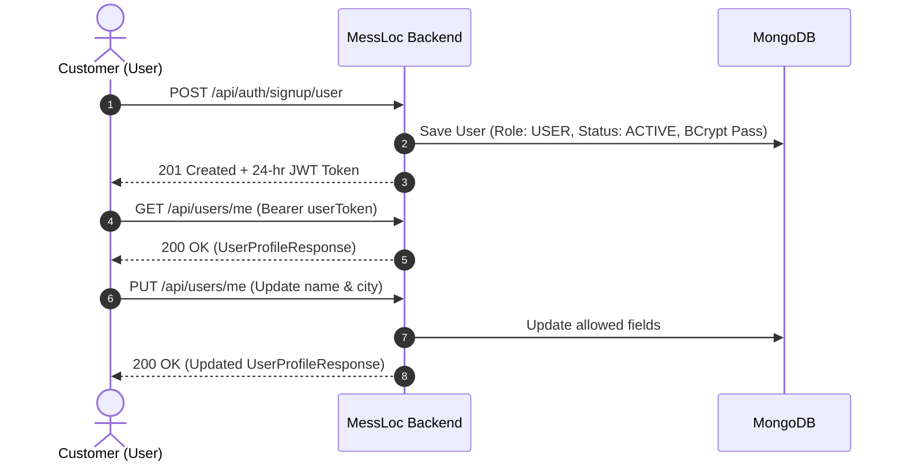
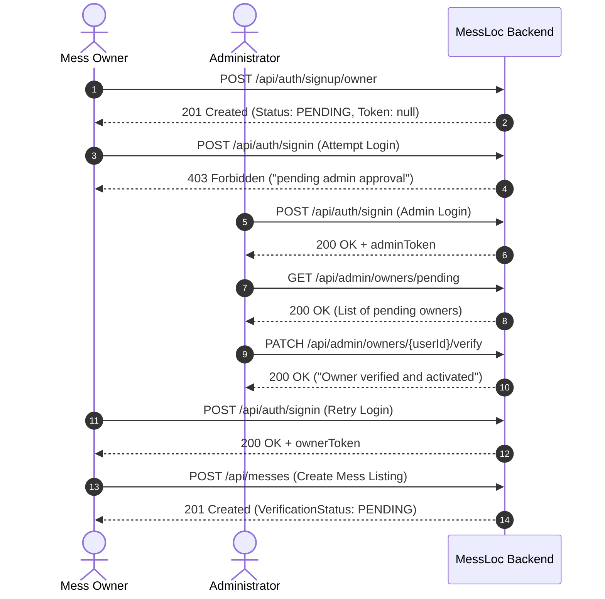

# MessLoc — Postman Testing Guide & Workflow Manual

> **Document:** Comprehensive Postman Testing Guide  
> **Backend URL:** `http://localhost:8080`  
> **Target Audience:** QA Engineers, Backend Developers, and Frontend Developers  

---

## 1. Prerequisites & Environment Setup

### 1.1 Start the MessLoc Backend
Ensure MongoDB is running locally on port `27017` and launch the Spring Boot application from the project root:

```bash
# Using Maven Wrapper from repository root
./backend/mvnw -f backend/pom.xml spring-boot:run

# Or using system Maven
mvn -f backend/pom.xml spring-boot:run
```

Confirm that the application outputs:
```
Tomcat started on port 8080 (http) with context path '/'
Started MessLocApplication in ... seconds
MessLoc: Initial ADMIN account successfully seeded!
```

Default seeded administrator credentials:
* **Email:** `admin@messloc.com`
* **Password:** `Admin@MessLoc123`
* **Role:** `ADMIN`

---

## 2. Importing the Postman Collection

1. Open Postman.
2. Click **Import** (top left).
3. Select or drag-and-drop [`messloc-api-documentation/messloc-postman-collection.json`](file:///Users/shivamkumar/Desktop/MessLock_01/messloc/messloc-api-documentation/messloc-postman-collection.json).
4. The collection **MessLoc API Collection** will appear with 6 organized module folders.

### 2.1 Collection Variables
The collection is pre-configured with the following variables:

| Variable Name | Default Value | Description |
|---|---|---|
| `baseUrl` | `http://localhost:8080` | Root API host and port |
| `userToken` | *(auto-populated)* | JWT token for authenticated customer (`ROLE_USER`) |
| `ownerToken` | *(auto-populated)* | JWT token for verified mess owner (`ROLE_OWNER`) |
| `adminToken` | *(auto-populated)* | JWT token for administrator (`ROLE_ADMIN`) |
| `messId` | *(auto-populated)* | ID of newly created mess listing |
| `ownerUserId` | *(auto-populated)* | ID of newly registered owner user |

> **Automatic Token Storage:**  
> The collection includes Postman **Tests** scripts on signin and signup requests. When you execute **Signin - Customer**, **Signin - Mess Owner**, or **Signin - Administrator**, the corresponding token variable (`userToken`, `ownerToken`, or `adminToken`) is **automatically extracted and saved** into collection variables!

---

## 3. End-to-End Testing Workflows

---

### Workflow 1: Customer (USER) Lifecycle



#### Step 1.1: Register Customer Account
* **Request:** `POST {{baseUrl}}/api/auth/signup/user`
* **Body (raw JSON):**
  ```json
  {
    "name": "Aman Verma",
    "email": "aman.verma@example.com",
    "password": "Password@123",
    "phone": "9876543210"
  }
  ```
* **Expected Response:** `201 Created`
  ```json
  {
    "success": true,
    "message": "User registered successfully",
    "token": "eyJhbGciOiJIUzUxMiJ9...",
    "tokenType": "Bearer",
    "expiresInMs": 86400000,
    "user": {
      "id": "672f0...",
      "name": "Aman Verma",
      "email": "aman.verma@example.com",
      "phone": "9876543210",
      "city": null,
      "role": "USER",
      "status": "ACTIVE"
    }
  }
  ```
* *Test Script automatically saves `userToken`.*

#### Step 1.2: Check Profile
* **Request:** `GET {{baseUrl}}/api/users/me`
* **Header:** `Authorization: Bearer {{userToken}}`
* **Expected Response:** `200 OK`

#### Step 1.3: Update Profile
* **Request:** `PUT {{baseUrl}}/api/users/me`
* **Header:** `Authorization: Bearer {{userToken}}`
* **Body (raw JSON):**
  ```json
  {
    "name": "Aman V. Sharma",
    "phone": "9876500000",
    "city": "Dehradun",
    "profileImage": "https://example.com/avatar.jpg"
  }
  ```
* **Expected Response:** `200 OK` with updated name and city.

---

### Workflow 2: Mess Owner (OWNER) Approval & Listing Lifecycle



#### Step 2.1: Register Mess Owner
* **Request:** `POST {{baseUrl}}/api/auth/signup/owner`
* **Body (raw JSON):**
  ```json
  {
    "name": "Karan Joshi",
    "email": "karan.owner@example.com",
    "password": "OwnerPass@123",
    "phone": "9812345678",
    "businessName": "Karan Bhojnalaya & Tiffin Service",
    "businessDescription": "Authentic North Indian thali and student tiffin service.",
    "businessAddress": "Plot 12, Clock Tower, Dehradun",
    "fssaiLicenseNumber": "12345678901234"
  }
  ```
* **Expected Response:** `201 Created`
  * `user.role`: `OWNER`
  * `user.status`: `PENDING`
  * `token`: `null` (Owners awaiting verification are NOT issued tokens).
* *Test Script automatically saves `ownerUserId`.*

#### Step 2.2: Verify Owner Signin is BLOCKED While Pending
* **Request:** `POST {{baseUrl}}/api/auth/signin`
* **Body (raw JSON):**
  ```json
  {
    "email": "karan.owner@example.com",
    "password": "OwnerPass@123"
  }
  ```
* **Expected Response:** `403 Forbidden`
  ```json
  {
    "success": false,
    "status": 403,
    "message": "Your account is pending admin approval. Please wait for verification."
  }
  ```

#### Step 2.3: Admin Login
* **Request:** `POST {{baseUrl}}/api/auth/signin`
* **Body:**
  ```json
  {
    "email": "admin@messloc.com",
    "password": "Admin@MessLoc123"
  }
  ```
* **Expected Response:** `200 OK` (Saves `adminToken`).

#### Step 2.4: Admin Verifies Owner Account
* **Request:** `PATCH {{baseUrl}}/api/admin/owners/{{ownerUserId}}/verify`
* **Header:** `Authorization: Bearer {{adminToken}}`
* **Expected Response:** `200 OK`
  ```json
  {
    "success": true,
    "status": 200,
    "message": "Owner verified and activated successfully",
    "data": null
  }
  ```

#### Step 2.5: Owner Login (Now Successful)
* **Request:** `POST {{baseUrl}}/api/auth/signin` with owner credentials.
* **Expected Response:** `200 OK` (Saves `ownerToken`).

#### Step 2.6: Owner Creates Mess Listing
* **Request:** `POST {{baseUrl}}/api/messes`
* **Header:** `Authorization: Bearer {{ownerToken}}`
* **Body (raw JSON):**
  ```json
  {
    "name": "Annapurna Royal Mess",
    "description": "Premium pure veg North Indian meals with unlimited chapatis and salad.",
    "address": "45/2 Subhash Nagar, Near Graphic Era University",
    "city": "Dehradun",
    "state": "Uttarakhand",
    "pincode": "248002",
    "latitude": 30.2687,
    "longitude": 77.9942,
    "contactNumber": "9876543210",
    "monthlyPrice": 3200.0,
    "foodType": "VEG",
    "openingTime": "07:30",
    "closingTime": "22:00",
    "facilities": ["RO Water", "High-Speed WiFi", "AC Dining Hall"]
  }
  ```
* **Expected Response:** `201 Created`
  * `verificationStatus`: `PENDING`
  * `status`: `ACTIVE`
* *Test Script automatically saves `messId`.*

#### Step 2.7: Owner Views & Updates Listing
* **Get My Messes:** `GET {{baseUrl}}/api/owner/messes` (Header: `Authorization: Bearer {{ownerToken}}`)
* **Update Mess:** `PUT {{baseUrl}}/api/owner/messes/{{messId}}` (Header: `Authorization: Bearer {{ownerToken}}`)
* **Deactivate Mess:** `PATCH {{baseUrl}}/api/owner/messes/{{messId}}/deactivate` (Temporarily hides mess from public)
* **Activate Mess:** `PATCH {{baseUrl}}/api/owner/messes/{{messId}}/activate` (Re-activates mess)

---

### Workflow 3: Admin Mess Approval & Public Discovery

#### Step 3.1: Check Public Discovery Before Approval
* **Request:** `GET {{baseUrl}}/api/messes`
* **Header:** None (Public)
* **Expected Result:** The newly created mess is **NOT present** in the array because its `verificationStatus` is `PENDING`.

#### Step 3.2: Admin Approves the Mess
* **Request:** `PATCH {{baseUrl}}/api/admin/messes/{{messId}}/approve`
* **Header:** `Authorization: Bearer {{adminToken}}`
* **Expected Response:** `200 OK` (`"Mess approved successfully"`).

#### Step 3.3: Verify Public Discovery After Approval
* **Request:** `GET {{baseUrl}}/api/messes`
* **Expected Result:** `200 OK` — The mess **now appears** in the list!

#### Step 3.4: Test City Filter
* **Request:** `GET {{baseUrl}}/api/messes?city=Dehradun`
* **Expected Result:** `200 OK` — Returns messes in Dehradun.
* **Request:** `GET {{baseUrl}}/api/messes?city=Bangalore`
* **Expected Result:** `200 OK` with an empty array `[]`.

---

## 4. Error Handling & Security Boundary Test Cases

| Case | Request | Headers / Auth | Expected Code | Expected Error Payload |
|---|---|---|---|---|
| **Invalid Credentials** | `POST /api/auth/signin` with bad password | None | `401 Unauthorized` | `{"success":false,"status":401,"message":"Invalid email or password"}` |
| **Missing JWT** | `GET /api/users/me` | None | `401 Unauthorized` | `{"success":false,"status":401,"message":"Unauthorized..."}` |
| **Expired / Malformed JWT** | `GET /api/users/me` | `Authorization: Bearer bad.token` | `401 Unauthorized` | `{"success":false,"status":401,"message":"Unauthorized..."}` |
| **Role Violation (Customer accessing Admin)** | `GET /api/admin/test` | `Bearer {{userToken}}` | `403 Forbidden` | `{"success":false,"status":403,"message":"Access denied..."}` |
| **Role Violation (Owner accessing Admin)** | `GET /api/admin/messes` | `Bearer {{ownerToken}}` | `403 Forbidden` | `{"success":false,"status":403,"message":"Access denied..."}` |
| **Cross-Tenant IDOR (Owner 2 editing Owner 1's mess)** | `PUT /api/owner/messes/{otherOwnerMessId}` | `Bearer {{owner2Token}}` | `403 Forbidden` | `{"success":false,"status":403,"message":"You are not authorized to manage this mess"}` |
| **Invalid Coordinates** | `POST /api/messes` with `latitude: 999.0` | `Bearer {{ownerToken}}` | `400 Bad Request` | `{"success":false,"status":400,"data":{"latitude":"Latitude must be between -90 and 90"}}` |
| **Invalid Time Ordering** | `POST /api/messes` with `openingTime: 22:00, closingTime: 08:00` | `Bearer {{ownerToken}}` | `400 Bad Request` | `{"success":false,"status":400,"message":"Opening time must be before closing time"}` |
| **Duplicate Email** | `POST /api/auth/signup/user` with existing email | None | `409 Conflict` | `{"success":false,"status":409,"message":"An account is already registered with email..."}` |
| **Non-existent Resource** | `GET /api/messes/nonexistentid` | None | `404 Not Found` | `{"success":false,"status":404,"message":"Mess not found with id: ..."}` |

